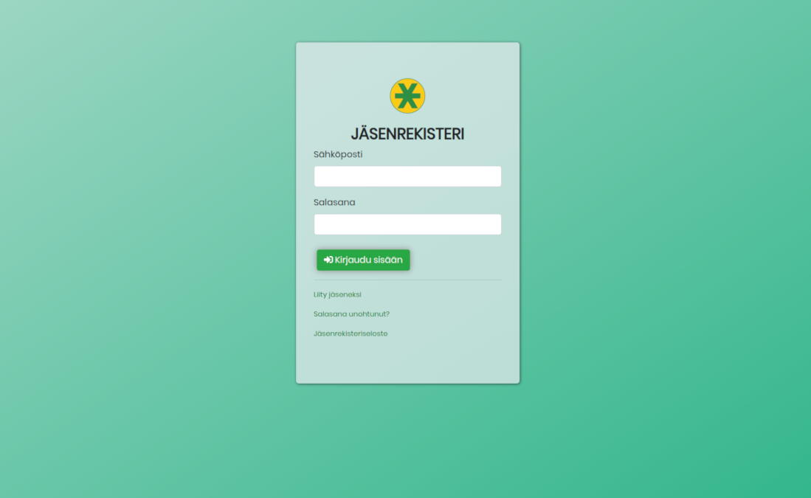

# Jäsenrekisteri frontend

Asteriski ry's membership register UI. Node **24.16.0**, React 16, React Router 5 and Vite 7.

Author: [Maks Turtiainen](https://github.com/mjturt)

Node.js backend: <https://github.com/asteriskiry/jasenrekisteri-backend>.

## Run with Docker

Place this repository beside `jasenrekisteri-backend` and follow the [backend Compose instructions](../jasenrekisteri-backend/README.md). The stack serves this application at <http://localhost:8080> and proxies `/api/` to the backend.

The image uses a Vite build stage and an unprivileged Nginx runtime with SPA routing. `VITE_USE_PAYMENT` is a build argument, configured through the backend Compose `.env`; changing it requires rebuilding. Stripe secrets belong only in the backend environment.

## Develop

```sh
cp .env-sample .env
npm ci
npm run dev
```

The development server uses port 5173. Set backend `CLIENTURL=http://localhost:5173` when testing Stripe through Vite, and configure `VITE_API_URL` in this repository's `.env`.

```sh
npm run lint
npm test
npm run build
```

The static build is written to `dist/`. Payment tests cover API response compatibility, cookie-based receipt access, pending webhook confirmation, failures and canceled polling. Receipt access and its expiry are described in the [backend payment instructions](../jasenrekisteri-backend/README.md#stripe).

GitHub Actions runs locked installation, lint, tests and a Docker build on pull requests and development/mainline pushes. Deployment is a separate manual setup; see [CI/CD](../jasenrekisteri-backend/docs/ci-cd.md).

The package-update branch is merged, but React/Router upgrades remain separate work. See the [modernization review](../jasenrekisteri-backend/docs/modernization-review.md).

## Screenshots




---

© Asteriski ry
